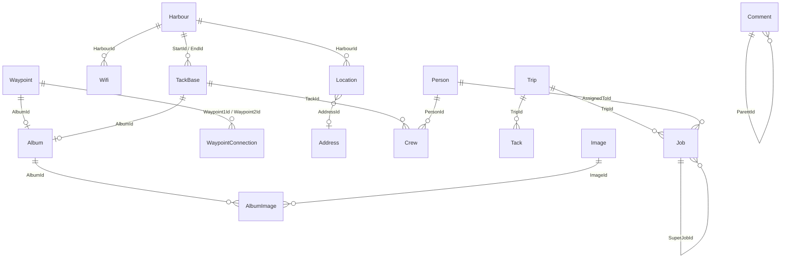

# 2. Domain Model and Database

Sources: `SMS/src/SMS/Models/*.cs`, `Migrations/SmsDbContextModelSnapshot.cs`,
`Migrations/20160626*.cs`, `wwwroot/js/ClientModel.ts`.

Two EF Core contexts share **one SQL Server database**:

- `ApplicationDbContext : IdentityDbContext<ApplicationUser>` – standard Identity
  tables (`AspNetUsers`, …). `ApplicationUser` has no extra properties.
- `SmsDbContext : DbContext` – all domain tables below.

## 2.1 Common entity base (all "IEntity" types)

Every entity except the three join tables (`AlbumImage`, `Crew`,
`WaypointConnection`) has:

| Property | Type | Persisted | Notes |
|----------|------|-----------|-------|
| `Id` | `int?` | yes, identity PK | `null`/absent = new entity |
| `InsertDate` | `DateTime` | yes | set to `DateTime.Now` by server on insert |
| `UpdateDate` | `DateTime` | yes | set to `DateTime.Now` by server on update (stays `0001-01-01` until first update) |
| `ClientId` | `int?` | no (`[NotMapped]`) | client-side temporary id, echoed back so the client can match nested objects in responses |
| `ProcessOnSever` (sic) | `bool?` | no | intended "skip this nested object" flag; client sends `ProcessOnServer` – the misspelling means it never binds (see `06`) |
| `Type` | `string` (get-only) | no | `GetType().Name` → `"Waypoint"`, `"Harbour"`, `"Trip"`, `"Tack"`, `"LogBookEntry"`, … – used by client to discriminate polymorphic results |

## 2.2 Entities

Inheritance uses **TPH (table-per-hierarchy)** with a `Discriminator` string
column:
- table `Waypoint`: `Waypoint`, `Harbour`
- table `TackBase`: `Tack`, `Trip`, `LogBookEntry` (abstract base `TackBase`)

### Waypoint (table `Waypoint`, discriminator `"Waypoint"`)
A point on the map that is part of the navigable route graph.

| Property | Type | Req. | Notes |
|----------|------|------|-------|
| `WaypointNumber` | `int?` | | "Wegpunkt-Nr." (e.g. number in the chart plotter) |
| `Name` | `string` | | |
| `Description` | `string` | | not shown in current UI |
| `Latitude` | `double` | ✔ | WGS84 |
| `Longitude` | `double` | ✔ | WGS84 |
| `AlbumId` / `Album` | `int?` / `Album` | | plain waypoints normally have no album |

### Harbour : Waypoint (discriminator `"Harbour"`)
| Property | Type | Notes |
|----------|------|-------|
| `Website` | `string` | URL |
| `Content` | `string` | rich-text HTML (TinyMCE) |
| `Rating` | `double` | rating UI is commented out |
| `Locations` | `List<Location>` | not used by UI |
| `Wifis` | `List<Wifi>` | |
| `AlbumId`/`Album` | inherited | client always creates an album for a new harbour |

### TackBase (abstract, table `TackBase`)
A sailed/planned leg between two harbours.

| Property | Type | Req. | Notes |
|----------|------|------|-------|
| `StartDate` | `DateTime` | ✔ | departure ("Abgelegt") |
| `EndDate` | `DateTime` | ✔ | arrival ("Festgemacht") |
| `Distance` | `double?` | | nautical miles (only filled by trip planner) |
| `StartId` / `Start` | `int?` / `Harbour` | ✔ | FK → Waypoint(Harbour), cascade |
| `EndId` / `End` | `int?` / `Harbour` | ✔ | FK → Waypoint(Harbour), cascade |
| `Crew` | `List<Crew>` | ✔ | join rows to `Person` |
| `Persons` | `List<Person>` | not mapped | unused on server; client derives persons from `Crew` |
| `AlbumId` / `Album` | `int?` / `Album` | | client always creates an album on insert |

### LogBookEntry : TackBase (discriminator `"LogBookEntry"`)
| Property | Type | UI label |
|----------|------|----------|
| `MotorHoursStart` | `decimal` | Motorstunden (Start) |
| `MotorHoursEnd` | `decimal` | Motorstunden (Ziel) |
| `LogStart` | `decimal` | Logge (Start) – log (odometer) reading |
| `LogEnd` | `decimal` | Logge (Ziel) |
| `WindSpeed` | `string` in C# (**`decimal`** in migration/snapshot!, number in TS) | Windgeschwindigkeit – free text input in UI |
| `WindDirection` | `string` | Windrichtung – one of 16 compass points `N, NNO, NO, ONO, O, OSO, SO, SSO, S, SSW, SW, WSW, W, WNW, NW, NNW` (German: O = Ost) |
| `SpecialOccurences` | `string` | Besondere Vorkommnisse – rich-text HTML |

### Trip : TackBase (discriminator `"Trip"`)
| Property | Type | Notes |
|----------|------|-------|
| `Name` | `string` | |
| `Content` | `string` | HTML |
| `Tacks` | `List<Tack>` | legs of the trip (FK `Tack.TripId`) |
| `IsDummy` | `bool` | "dummy" trips = calendar placeholders exported via iCal |

### Tack : TackBase (discriminator `"Tack"`)
| Property | Type | Notes |
|----------|------|-------|
| `TripId` | `int?` | FK → Trip |

### Person (table `Person`)
| Property | Type | Req. |
|----------|------|------|
| `FirstName` | `string` | ✔ |
| `LastName` | `string` | ✔ |
| `Tasks` | `List<Job>` | navigation only (FK `Job.AssignedToId`) |

Client computed: `FullName = FirstName + " " + LastName`.

### Job (table `Job`) – tasks / to-dos
| Property | Type | Req. | Notes |
|----------|------|------|-------|
| `Title` | `string` | ✔ | |
| `Content` | `string` | | HTML |
| `DueTo` | `DateTime` | | "Fällig bis" |
| `Done` | `bool` | | "Erledigt" |
| `AssignedToId` / `AssignedTo` | `int?` / `Person` | | "Zuständig" |
| `SuperJobId` / `SuperJob` | `int?` / `Job` | | parent task (tree) |
| `SubJobs` | `List<Job>` | | children |
| `TripId` / `Trip` | `int?` / `Trip` | | not used by UI |

### Wifi (table `Wifi`)
| Property | Type | Req. | Notes |
|----------|------|------|-------|
| `Name` | `string` | ✔ | SSID |
| `Password` | `string` | | shown as `-` if empty |
| `Speed` | `int` | | 0 = Schlecht, 1 = Mäßig, 2 = Gut, 3 = Sehr Gut |
| `Free` | `bool` | | "Gratis" |
| `HarbourId` | `int` | ✔ | FK → Harbour, cascade |

### ContentPage (table `ContentPage`)
| Property | Type | Req. |
|----------|------|------|
| `Title` | `string` | ✔ |
| `Content` | `string` (HTML) | ✔ |

### Album (table `Album`)
| Property | Type | Notes |
|----------|------|-------|
| `Title` | `string` | unused |
| `StandAlone` | `bool` | unused (idea: albums not attached to an entity) |
| `AlbumImages` | `List<AlbumImage>` | persisted join |
| `Images` | `List<Image>` | **not mapped**; client sends/reads images here; server syncs `AlbumImages` from it on save |

### Image (table `Image`)
| Property | Type | Notes |
|----------|------|-------|
| `Path` | `string` | web path of the original, e.g. `/images/upload/636025791390311847/01.jpg` |
| `Width`, `Height` | `int` | pixel size of the original (needed by PhotoSwipe) |

Thumbnail URL is derived, not stored: `"/thumbs" + Path + ".jpg"`.

### AlbumImage (table `AlbumImage`) – join
PK (`AlbumId`, `ImageId`); both FKs cascade; `Index int?` (ordering, unused).

### Crew (table `Crew`) – join Person ↔ TackBase
PK (`PersonId`, `TackId`); both FKs cascade.

### WaypointConnection (table `WaypointConnection`) – graph edge
PK (`Waypoint1Id`, `Waypoint2Id`); both FKs → Waypoint, cascade.
The graph is **undirected**: (a,b) and (b,a) are treated as the same edge by
the API (`Exists`, `Disconnect`).

### Location, Address, LocationType, Comment – modelled but unused in the UI
- `Location`: `HarbourId`, `Website`, `Name`, `Rating`, `AddressId`/`Address`
  (points of interest near a harbour; DB still has an `int LocationType`
  column although the property is commented out).
- `Address`: `Street`, `Zip`, `Town`, `Comment`.
- `LocationType` enum: `Restaurant, Supermarket, Club, Park, HomeImprovment, ShipSupplies`.
- `Comment`: `Title`, `Content`, `Rating`, required `ParentId` (self-FK, cascade).
  No API controller exists for comments.

These may be re-implemented later ("Points of interest", "comments/ratings"),
but are **not required** for feature parity.

## 2.3 Entity-relationship diagram


(`Harbour` ⊂ `Waypoint`; `Trip`, `Tack`, `LogBookEntry` ⊂ `TackBase`.)

## 2.4 Save semantics (server `AddOrUpdate`)

Each entity implements `AddOrUpdate(SmsDbContext)` and `RemoveFromContext(SmsDbContext)`
and the generic controller calls them (see `03`). Behaviour:

- `Id == null` → `context.Add(this)`, `InsertDate = now`.
- `Id < 0` → ignored.
- otherwise → `context.Update(this)`, `UpdateDate = now`.
- Nested objects are saved recursively:
  - `Waypoint`/`TackBase` → `Album?.AddOrUpdate` → album syncs `AlbumImages`
    from the posted `Images` list (adds missing links, removes links whose
    image is no longer in the list).
  - `Harbour` → each `Location` (+ its `Address`) and each `Wifi`.
  - `TackBase` → **Crew sync**: posted `Crew` list (`{PersonId, TackId}`) is
    compared to DB rows for this tack; missing rows are added.
  - `Trip` → each `Tack`.

## 2.5 Delete semantics (server `RemoveFromContext`, application-level cascade)

| Deleting | Also deletes |
|----------|--------------|
| Waypoint/Harbour | all `WaypointConnection`s touching it, its `Album` (+ `AlbumImage` links; `Image` rows and files are **not** deleted) |
| Harbour (additionally) | its `Location`s (+ their `Address`) and `Wifi`s |
| TackBase (Tack/Trip/LogBookEntry) | its `Crew` rows, its `Album` (+ links) |
| Trip (additionally) | its `Tack`s |
| Job | all sub-jobs recursively |
| Person | its `Crew` rows **and** (via `Crew.RemoveFromContext`) apparently the tacks/logbook entries those crew rows point to, plus all jobs assigned to the person — almost certainly unintended, see `06` |
| Location | its `Address` |

In addition the DB has FK cascades listed in §2.2 (e.g. deleting a harbour
cascades to `TackBase` rows that start/end there).

**Recommendation for the rewrite:** use explicit EF Core relationship
configuration; deleting a harbour that is used by logbook entries should be
**blocked** (or soft-deleted), deleting a person should only remove crew links /
unassign jobs, and image files should be removed when their image row is
removed.

## 2.6 Wire format (JSON DTOs used by the legacy client)

PascalCase, navigation properties usually `null`/empty because the API never
uses `Include`. The client resolves relations itself from IDs. Example harbour
from `GET /api/Waypoints`:

```json
{
  "Website": "http://…", "Content": "<p>…</p>", "Locations": [], "Rating": 0, "Wifis": [],
  "WaypointNumber": 12, "Name": "Kiel-Holtenau", "Description": null,
  "Latitude": 54.37, "Longitude": 10.15, "ClientId": null, "ProcessOnSever": null,
  "Id": 7, "InsertDate": "2016-06-26T20:41:14", "UpdateDate": "0001-01-01T00:00:00",
  "Album": null, "AlbumId": 3, "Type": "Harbour"
}
```

Logbook entry create payload sent by the client (simplified):

```json
{
  "ClientId": 42, "StartId": 7, "EndId": 9,
  "StartDate": "2016-07-01T08:00:00.000Z", "EndDate": "2016-07-01T15:30:00.000Z",
  "MotorHoursStart": 120.5, "MotorHoursEnd": 121.0, "LogStart": 3000, "LogEnd": 3032,
  "WindSpeed": "4 Bft", "WindDirection": "SW", "SpecialOccurences": "<p>…</p>",
  "Distance": 0,
  "Album": { "ClientId": 43, "Images": [] },
  "Crew": [ { "PersonId": 1, "TackId": null }, { "PersonId": 2, "TackId": null } ]
}
```
