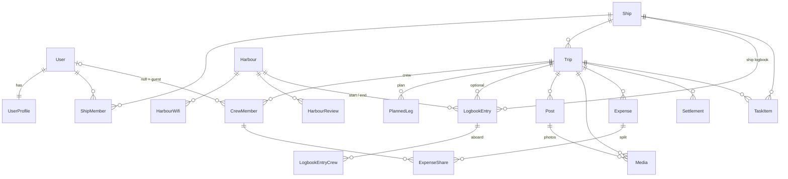

# 8. New Domain Model, Permissions and Visibility

Target model for the multi-ship portal (`07`). Legacy model: `02`. All ids are
`Guid` (safer in public URLs than sequential ints); all timestamps
`DateTimeOffset` (UTC); every aggregate has `CreatedAt`, `CreatedById`,
`UpdatedAt`, `UpdatedById`. Soft delete (`DeletedAt`) for user content so
deletions can be reverted by moderators for 30 days.

## 8.1 Entities

### Identity and social
| Entity | Key fields | Notes |
|--------|-----------|-------|
| `User` (Identity) | Email, EmailConfirmed, PasswordHash, … | ASP.NET Core Identity |
| `UserProfile` | UserId (PK/FK), DisplayName, AvatarMediaId?, Bio, HomeHarbourId?, Experience, ProfileVisibility (`Public`/`Registered`), DefaultContentVisibility, Language, NotificationSettings (json) | 1:1 with User |
| `Follow` | FollowerId, TargetType (`User`/`Ship`), TargetId, CreatedAt | PK (FollowerId, TargetType, TargetId) |
| `Comment` | Id, TargetType (`Post`/`Media`/`LogbookEntry`/`Trip`/`HarbourReview`), TargetId, AuthorId, Text, CreatedAt | visible iff target visible to viewer |
| `Reaction` | TargetType, TargetId, UserId, Type (`Like`) | PK (TargetType, TargetId, UserId) |
| `Notification` | Id, UserId, Type, PayloadJson, ReadAt | in-app notifications |
| `Report` | Id, TargetType, TargetId, ReporterId, Reason, Status | moderation |

### Ships
| Entity | Key fields | Notes |
|--------|-----------|-------|
| `Ship` | Id, Name, Type, LengthM, BeamM, DraftM, AirDraftM, SailNumber, CallSign, Mmsi, HomeHarbourId?, CruisingSpeedKn (default 5), PhotoMediaId?, Description, Visibility (`Public`/`Private`) | |
| `ShipMember` | ShipId, UserId, Role (`Owner`/`Skipper`), Since | PK (ShipId, UserId); ≥ 1 owner |
| `ShipInvitation` | Id, ShipId, Email or UserId, Role, Token, ExpiresAt, Status | |

### Trips
| Entity | Key fields | Notes |
|--------|-----------|-------|
| `Trip` | Id, ShipId, Name, Description, StartDate, EndDate (dates), TimeZone (IANA, default `Europe/Berlin`), PlannedStartHarbourId?, PlannedEndHarbourId?, SkipperId (CrewMember), Visibility (`Crew`/`Public`), Status (`Planned`/`Active`/`Completed`/`Cancelled`), Currency (ISO 4217), CostsLockedAt? | |
| `CrewMember` | Id, TripId, UserId? (null = guest), GuestName?, Role (`Skipper`/`CoSkipper`/`Crew`), Status (`Invited`/`Accepted`/`Declined`/`Left`), FromDate?, ToDate? | separate Id so guests can be referenced by logbook and costs; a guest can later be linked to a user (set UserId) |
| `TripInvitation` | Id, TripId, Email?, Token, Role, ExpiresAt, Status | invite link / mail |
| `PlannedLeg` | Id, TripId, Order, FromHarbourId, ToHarbourId, PlannedDate?, DistanceNm (cached), RouteGeometry (cached LineString) | trip planner (legacy Trip/Tack idea) |
| `TaskItem` | Id, Scope (`Trip`/`Ship`), TripId?/ShipId?, ParentId?, Title, Content, DueDate?, AssigneeCrewMemberId? / AssigneeUserId?, Done | legacy `Job` |

### Logbook
| Entity | Key fields | Notes |
|--------|-----------|-------|
| `LogbookEntry` | Id, ShipId, TripId?, StartHarbourId, EndHarbourId, DepartedAt, ArrivedAt, EngineHoursStart/End (decimal), LogStart/End (decimal nm), WindSpeed (string, e.g. "4 Bft"), WindDirection (enum 16 compass points: N, NNE/NNO, …), Weather, SeaState, SailedDistanceNm?, Notes (sanitised HTML), TrackMediaId? (GPX), Visibility (`Private`/`Crew`/`Public`), AuthorId | legacy LogBookEntry; private = draft |
| `LogbookEntryCrew` | LogbookEntryId, CrewMemberId? or UserId?/GuestName | who was aboard; for entries without trip use ship members/guest names |

### Content and media
| Entity | Key fields | Notes |
|--------|-----------|-------|
| `Post` | Id, TripId, AuthorId, Day (date in trip time zone), Title?, Content (sanitised HTML), HarbourId?, Location (Point)?, Visibility, PublishedAt | blog post |
| `Media` | Id, OwnerId, TripId?, ShipId?, PostId?, LogbookEntryId?, HarbourId?, Kind (`Photo`/`Gpx`/`Receipt`/`Avatar`), StorageKey, OriginalFileName, ContentType, SizeBytes, Width, Height, TakenAt?, Day?, Location (Point)?, Caption, Visibility, ProcessingStatus | variants (thumb 400 px, preview 1600 px, original) derived from StorageKey |

`Day` is the trip-local calendar date that groups items into the timeline.
For photos it is taken from EXIF `DateTimeOriginal` (converted with the trip
time zone) if it lies within the trip dates, else from the upload time. Users
may change it.

### Costs (details in `09`)
| Entity | Key fields |
|--------|-----------|
| `Expense` | Id, TripId, PaidByCrewMemberId, Amount (decimal), Currency, ExchangeRate (to trip currency, decimal 18,8), AmountInTripCurrency (computed & stored, minor-unit rounded), Date, Category, Description, ReceiptMediaId?, SplitMode (`Equal`/`Weights`/`Exact`), CreatedById |
| `ExpenseShare` | ExpenseId, CrewMemberId, Weight? / ExactAmount?, ComputedShare (trip currency) |
| `Settlement` | Id, TripId, FromCrewMemberId, ToCrewMemberId, Amount (trip currency), PaidAt, Status (`Reported`/`Confirmed`), Note |

### Harbours and routing (details in `10`)
| Entity | Key fields | Notes |
|--------|-----------|-------|
| `Harbour` | Id, Name, Location (Point), Country, Website, Description (HTML), OsmType/OsmId? (source), Source (`Osm`/`User`/`Legacy`), Category (Marina/Hafen/Ankerplatz/…), Facilities (json: water, power, fuel, toilets, showers…), Phone, VhfChannel, IsActive, MergedIntoId? | global catalogue |
| `HarbourRevision` | Id, HarbourId, ChangedById, ChangedAt, SnapshotJson | edit history / revert |
| `HarbourWifi` | Id, HarbourId, Name, Password, Speed (0–3), Free | legacy Wifi |
| `HarbourReview` | Id, HarbourId, AuthorId, Rating (1–5), Text, VisitedOn? | |
| `RoutingCorrection` | Id, Kind (`Block`/`Passage`), Geometry (Polygon or LineString), Note, CreatedById, Active | manual fixes for routing |
| `RouteCache` | FromHarbourId, ToHarbourId, GraphVersion, DistanceNm, Geometry | cache of computed sea routes |

### Platform
| Entity | Key fields |
|--------|-----------|
| `ContentPage` | Id, Slug, Title, Content, Language, ShowInFooter |

Spatial columns use NetTopologySuite types (SQL Server `geography` or
PostGIS `geography(Point,4326)`).

## 8.2 Relationships (overview)

Delete rules: deleting a ship requires deleting its trips first (or a
confirmed "delete everything"); harbours referenced by logbook entries cannot
be deleted, only merged/deactivated; deleting a user anonymises crew members,
logbook crew and costs (keeps the numbers balanced) and deletes posts/media.

## 8.3 Visibility rules

`Visibility` values: `Private` ("Privat"), `Crew` ("Crew"), `Public`
("Öffentlich"). Order: Private < Crew < Public.

**Effective visibility** of an item inside a trip:
`min(item.Visibility, trip.Visibility, ship.Visibility == Private ? Crew : Public)`.

Who may **view** an item with effective visibility:

| Effective | Viewer allowed if … |
|-----------|---------------------|
| `Private` | viewer is the author (and platform admins for moderation) |
| `Crew` | viewer is an **accepted** crew member of the trip (any role), or the author; for logbook entries and the cost summary also ship owners/skippers |
| `Public` | anyone, including anonymous |

Additional rules:
- Items **without trip** (ship logbook entries outside trips, ship-level tasks):
  "crew" means ship members (owners/skippers).
- Crew members who joined for part of the trip (`FromDate`/`ToDate`) still see
  the whole trip (simpler; revisit if needed).
- Comments/likes inherit the visibility of their target; you can only comment
  on what you can see.
- Costs are never public: visible to accepted crew + ship owners.
- Harbour WiFi passwords: registered users only.
- Every list/query endpoint must apply these rules in the database query
  (central `IVisibilityFilter` / EF query extension) — add authorization tests
  for each row of §8.4.

## 8.4 Permission matrix

| Action | Anonymous | Registered | Ship owner | Ship skipper | Trip skipper / co-skipper | Crew member | Author |
|--------|-----------|-----------|-----------|--------------|---------------------------|-------------|--------|
| View public content | ✔ | ✔ | ✔ | ✔ | ✔ | ✔ | ✔ |
| Create ship | | ✔ | | | | | |
| Edit ship, manage ship members | | | ✔ | | | | |
| Create trip for ship | | | ✔ | ✔ | | | |
| Edit trip, manage crew, lock costs | | | ✔ | | ✔ (skipper only for crew/lock) | | |
| Write logbook entry | | | ✔ | ✔ | ✔ | | |
| Edit/delete logbook entry | | | ✔ | | ✔ | | ✔ |
| Write post / upload photo in trip | | | | | ✔ | ✔ | |
| Edit/delete post or photo | | | | | delete only (moderation within trip) | | ✔ |
| Add expense | | | | | ✔ | ✔ | |
| Edit/delete expense | | | | | ✔ (until locked) | | ✔ (until locked) |
| Report settlement payment | | | | | ✔ | ✔ (as payer) | |
| Confirm settlement | | | | | | ✔ (as receiver) | |
| Comment / like visible item | | ✔ | ✔ | ✔ | ✔ | ✔ | ✔ |
| Create/edit harbour, WiFi, review | | ✔ | | | | | |
| Delete/merge harbour, routing corrections, content pages, moderation | admin only | | | | | | |

Implement with ASP.NET Core policy-based authorization + resource handlers
(`IAuthorizationHandler<TRequirement, TResource>`), e.g. `CanEditTrip`,
`CanPostInTrip`, `CanViewItem`.

## 8.5 Mapping from legacy model

| Legacy (`02`) | New |
|---------------|-----|
| `Waypoint` (Harbour) | `Harbour` (catalogue, `Source = Legacy`, deduplicated against OSM) |
| `Waypoint` (plain) + `WaypointConnection` | not imported (automatic routing); optionally converted into `RoutingCorrection` passages |
| `LogBookEntry` | `LogbookEntry` of ship "Kairos"; trips reconstructed by grouping (see `11` phase 13) |
| `Person` + `Crew` | guest `CrewMember`s / `LogbookEntryCrew` (linkable to users later) |
| `Album`, `Image`, `AlbumImage` | `Media` (Photo) attached to logbook entry/harbour, `Day` = entry date |
| `Wifi` | `HarbourWifi` |
| `Job` | `TaskItem` (Scope = Ship) |
| `ContentPage` | `ContentPage` |
| `Trip`, `Tack` (dummy trips) | `Trip` with `PlannedLeg`s, Status = Planned |
